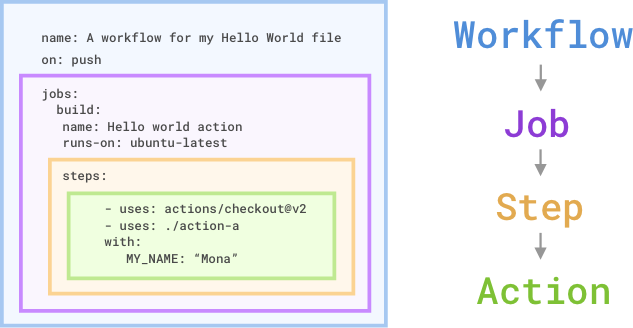
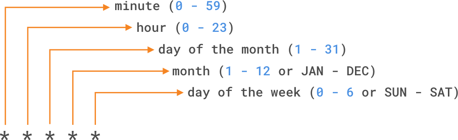
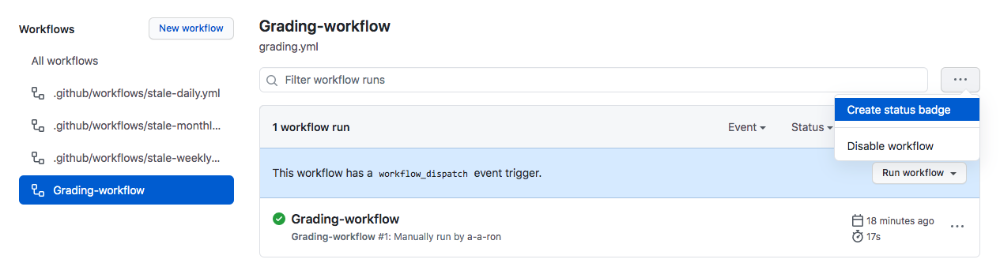

# GithubActions

> **Links**
>
> - [Introduction to Docker Containers](https://learn.microsoft.com/en-us/training/modules/intro-to-docker-containers/)
> - [Metadata syntax for Github Actions](https://docs.github.com/actions/creating-actions/metadata-syntax-for-github-actions)
> - [Security hardedning guidance for GitHub Actions](https://docs.github.com/en/actions/security-for-github-actions/security-guides/security-hardening-for-github-actions#using-third-party-actions)
> - [Usage limits, billing and administration](https://docs.github.com/actions/reference/usage-limits-billing-and-administration)
> - [Workflow syntax for GitHub Actions](https://docs.github.com/actions/reference/workflow-syntax-for-github-actions#jobsjob_idstepsif)


### What is GitHub Actions?
GitHub Actions are packaged scripts to automate tasks in a software-development workflow in GitHub.

#### GitHub Actions featured on the Actions tab, you can:
- Search for GitHub Actions in the [GitHub Marketplace](https://github.com/marketplace?type=actions). The GitHub Marketplace allows you to discover and purchase tools that extend your workflow.
- Search for open-source projects. For example, the [GitHub Actions](https://github.com/actions) organization features many popular open-source repos containing GitHub Actions you can use.
- Write your own GitHub Actions from scratch. You can make them open source, or even publish them to the GitHub Marketplace.

<br>

#### Types of GitHub actions
There are three types of GitHub actions:
- **Container actions**:<br>With container actions, the environment is part of the action's code. These actions can only be run in a Linux environment that GitHub hosts. Container actions support many different languages.

    ```yaml
    name: 'Composite Sample'
    description: 'Runs simple inline shell commands'
    runs:
    using: 'composite'
    steps:
        - shell: bash
        run: echo "Hello from a composite action step!"
    ```

- **JavaScript actions**:<br>JavaScript actions don't include the environment in the code. You have to specify the environment to execute these actions. You can run these actions in a VM (virtual machine) in the cloud or on-premises. JavaScript actions support Linux, macOS, and Windows environments.

    ```yaml
    name: 'JavaScript Sample'
    description: 'Runs inline JavaScript directly on the runner VM'
    runs:
    using: 'node20'
    main: 'data:text/javascript,console.log("Hello from JavaScript Action!");'
    ```

- **Composite actions**:<br>Composite actions allow you to combine multiple workflow steps within one action. For example, you can use this feature to bundle together multiple run commands into an action, and then have a workflow that executes the bundled commands as a single step using that action.

    ```yaml
    name: 'Container Sample'
    description: 'Runs a command inside an Alpine Docker image'
    runs:
        using: 'docker'
        image: 'docker://alpine:latest'
        args:
            - 'echo'
            - 'Hello from inside a Docker container!'
    ```

#### Using actions in workflows
Here are practical usage examples of how each of the three types of actions would be called inside a standard `.github/workflows/main.yml` file using the `uses:` block.

Assuming your action is stored locally in your repository under a folder named `.github/actions/my-action` (or you can reference remote marketplace actions via `owner/repo@version`), here is how they are triggered:


##### 1. Usage Example: Container Action
Container actions require a Linux runner (`ubuntu-latest`) because they execute inside a Docker container.

```yaml
jobs:
  run-container:
    runs-on: ubuntu-latest # Must be Linux for container actions
    steps:
      - name: Checkout Code
        uses: actions/checkout@v4

      - name: Run Docker Container Action
        id: container-step
        uses: ./.github/actions/my-container-action  # Path to your container action
        with:
          who-to-greet: 'Alice'

      - name: View Output
        run: echo "Container finished at: ${{ steps.container-step.outputs.time }}"

```

##### 2. Usage Example: JavaScript Action

JavaScript actions are cross-platform. Because they run directly on the virtual machine runner host, you can choose whichever OS you need (`ubuntu-latest`, `windows-latest`, or `macos-latest`).

```yaml
jobs:
  run-js:
    runs-on: ubuntu-latest # Can also be windows-latest or macos-latest
    steps:
      - name: Checkout Code
        uses: actions/checkout@v4

      - name: Run JavaScript Action
        id: js-step
        uses: ./.github/actions/my-javascript-action  # Path to your JS action
        with:
          name: 'Bob'

      - name: View Output
        run: echo "${{ steps.js-step.outputs.greeting }}"

```

##### 3. Usage Example: Composite Action

Composite actions wrap multiple steps into one. When you call it, it executes all those bundled steps seamlessly under a single line in your main workflow.

```yaml
jobs:
  run-composite:
    runs-on: ubuntu-latest
    steps:
      - name: Checkout Code
        uses: actions/checkout@v4

      - name: Run Setup & Test Bundle
        uses: ./.github/actions/my-composite-action  # Path to your composite action
        with:
          node-version: '20'
          
      # The workflow moves straight on because node setup, 
      # npm install, and tests were all handled inside the action!
      - name: Build Project
        run: npm run build

```

#### Referencing actions in workflows
When creating workflows in GitHub Actions, you can reference actions from various sources:
1. **A published Docker container image on Docker Hub**<br>Workflows can reference actions that are published as Docker container images on Docker Hub. These actions are containerized and include all dependencies required to execute the action. To use such action, you specify image in the `uses` attribure:
    ```yaml
    steps:
      - name: Run a Docker action
        uses: docker://<docker-image-name>:<version>
    ```

2. **Any public repository**<br>Actions in public repositories can be directly referenced in your workflows. These actions are accessible to anyone and can be used by specifying the repository name and version (Git ref, SHA or tag) in `uses` attribute:
    ```yaml
    steps:
      - name: Use a public action
        uses: actions/checkout@v3
    ```

> **Important**
>
> For better security, use a full commit SAH when referencing actions - not just a tag like `@v3`
> Example: `uses: actions/checkout@c2c1744e079e0dd11c8e0af4a96064ca4f6a2e9e`


3. **The same repository as your workflow file**<br>You can reference actions stored in the same repository as your workflow file. This feature is useful for custom actions that are specific to your project. To reference such actions, use a relative path to the action's directory:

    ```yaml
    steps:
      - name: Use a local action
        uses: ./.github/actions/my-action
    ```

4. **An enterprise marketplace**<br>If your organization uses GitHub Enterprise, you can reference actions from your enterprise's private marketplace. These actions are curated and managed by your organization, ensuring compliance wth internal standards:

    ```yaml
    steps:
      - name: Use an enterprise marketplace action
        uses: enterprise-org/action-name@v1
    ```

> **Note**
>
> Actions in private repositories can also be referenced, but they require proper authentication and permissions.

<br><br><br>

## Identify the components of gitHub Actions


A GitHub Actions execution hierarchy flows as follows: **Events** trigger **Workflows**, which contain **Jobs**, which execute **Steps**, which run **Actions** or shell commands.

| Component    | Description                                                            | Key Attributes / Reference                                                                    |
|--------------|------------------------------------------------------------------------|-----------------------------------------------------------------------------------------------|
| **Workflow** | Automated CI/CD process defined in `.github/workflows/`.               | Triggered by repository **events** (e.g., `push`); must contain at least one job.             |
| **Job**      | A distinct execution block assigned to a specific runtime environment. | Configured via `runs-on:` (targets GitHub-hosted or self-hosted runners, VMs, or containers). |
| **Step**     | A sequential task or execution block within a job.                     | Sequentially runs shell commands (`run:`) or actions (`uses:`).                               |
| **Action**   | Standalone, reusable executable units or commands.                     | Referenced via custom paths, community actions (e.g., `actions/checkout`), or inline scripts. |


<br><br><br>

## Configure a GitHub Actions workflow

#### Cofnigure workflow to run for scheduled events
The `schedule` event allows you to trigger a workflow to run at specific UTC time using [POSIX cron syntax](https://pubs.opengroup.org/onlinepubs/9699919799/utilities/crontab.html#tag_20_25_07). 



For example, if you want to run a workflow every 15 minutes, the schedule event looks like the following example:

```yaml
on:
  schedule:
    - cron: '*/15 * * * *'
```

Or if you want to execute job at 3:00am every Saturaday:

```yaml
on:
  schedule:
    - cron: '0 3 * * SUN'
```

> The shortest interval you can run a scheduled workflow is once every 5 minutes

<br>

### Configure workflow to run for manual events
In additon to scheduled events, you can manually trigger a workflow by using the `workflow_dispatch` event. This event allows you to run workflow by using the GitHub REST API or by selecting the **Run workflow** button in the **Actions** tab within your repository on GitHub. Using `workflow_dispatch`, you can choose on which branch and optionally with what input parameters you want to trigger the job. 

```yaml
on:
  workflow_dispatch:
    inputs:
      logLevel:
        description: 'Log level'
        required: true
        default: 'warning'
      tags:
        description: 'Test scenario tags'
```

In addition to `workflow_dispatch`, you can use the GitHub API to trigger a webhook event called `repository_dispatch`. This event allows you to trigger a workflow for activity that occurs outside of GitHub. It essentially serves as an HTTP request to your repository asking GitHub to trigger a workflow off an action or webhook. Using this manual event requires you to do two things: 
    1. Send a POST request to the GitHub endpoint `/repos/{owner}/{repo}/dispatches` with the webhook event names in the request body.
    2. Configure your workflow to use the `repository_dispatch` event.

<br><br><br>

### Configure workflows to run for webhook events

Lastly, you can configure a workflow to run when specific webhook events occur on GitHub. You can trigger most webhook events from more than once activity for a webhook. If multiple activities exist for a webhook, you can specify an activity type to triggerthe workflow. 

For example, you can run a workflow for the `check_run` event, but only for the `rerequested` or `requested_action` activity types.

```yaml
on:
  check_run:
    types: [rerequested, requested_action]
```

### `repository_dispatch`
`repository_dispatch` is a custom event in GitHub Actions that allows external systems (or even other GitHub workflows) to manually trigger workflows by sending a POST request to the GitHub API. It enables flexible automation and integration with outside tools, scripts, or systems that need to start woekflows in your repo.

#### Use cases
- Trigger workflows from external CI/CD tools.
- Coordinate multi-repo deployment (for example, Repo A finishes build -> triggers Repo B).
- Start Automation based on external events (webhooks, monitoring alerts, CRON jobs outside GitHub).
- Chain workflow executions between repositories or within monorepos.

**Example workflow that listens to repository_dispatch**
```yaml
name: Custom Dispatch Listener

on:
  repository_dispatch:
    types: [run-tests, deploy-to-prod]

jobs:
  run:
    run-on: ubuntu-latest
    steps:
      - name: Echo the payload
        run: | 
          echo "Event type: ${{ github.event.action }}"
          echo "Payload value: ${{ github.event.client_payload.env }}"
```

### Key elements
- `types`<br>Optional. Defines custom event types like `run-tests`, `deploy-to-prod`, etc.
- `github.event.client_payload`<br>Access to any other custom data passed in the dispatch event.
- `github.event.action`<br>Name of the `event_type` sent

### Trigger the event via API
You must send a POST request to the GitHub REST API v3 endpoint:
```sh
POST https://api.github.com/repos/OWNER/REPO/dispatches
```

### Authorization
- Requires a personal access token (PAT) with repo scope.
- For Organizations, ensure proper access setting for your token.

#### Sample commands structure
```sh
curl -X POST \
  -H "Accept: application/vnd.github+json" \
  -H "Authorization: token YOUR_GITHUB_TOKEN" \
  https://api.github.com/repos/OWNER/REPO/dispatches \
  -d '{"event_type":"run-tests","client_payload":{"env":"staging"}}'
```

**Payload structure**:

```json
{
  "event_type": "run-tests",
  "client_payload": {
    "env": "staging"
  }
}
```

<br><br><br>

### Use conditional keywords
Within your workflow file, you can access context information and evaluate expressions. Although expressions are commonly used with the condition `if` keyword in a workflow file to determine whether a step should run or not, you can use any supported context and expression to create a conditional.

It is important to know that when using conditional in your workflow, you need to use specific syntax `${{ <expression> }}`. This syntax tells GitHub to evaluate an expression rather than treat it as a string.

For example, a workflow that uses the `if` conditional to check if the `github.ref` (the branch or tag ref that triggered the workflow run) matches `refs/heads/main`. In order to proceed, the workflow would look somthing like this:

```yaml
name: CI
on: push
jobs:
  prod-check:
    if: github.ref == `refs/head/main`
    runs-on: ubuntu-latest
    steps:
      ...
```
> Notice that in this example the `${{  }}` are missing from syntax. With some expressions, like the `if` conditional, you can omit the expression syntax. GitHub automatically evaluates some of these common xpressions, but you can alwaus include them.

<br><br><br>

### Disable and delete workflows
After adding a workflow to your repository, you might find a situation where you want to temporarily disable the workflow. You can stop a workflow from being triggered without having to delete the file from the repo, either on GitHub or through the GitHub REST API. When you wish to enable the workflow again, you can easily do it using the same methods.


Disabling a workflow can be useful in some of the following situations:
- An error on a workflow is producing too many or wrong requests impacting external services negatively.
- You want to temporarily pause a workflow that isn't critical and is consuming too many minutes on your account.
- You want to pause a workflow that's sending requests to a service that is down.
- You're working on a fork, and you don't need all the functionality of some workflows it includes (like scheduled workflows).

You can also cancel a workflow run that's in progress in the GitHub UI from the Actions tab or by using the GitHub API endpoint `DELETE /repos/{owner}/{repo}/actions/runs/{run_id}`. Keep in mind that when you cancel a workflow run, GitHub cancels all of its jobs and steps within that run.


##### Use specific version of an action

When using action, it is recommended to specify a version to preent unexpected behaviour with udpates. See methods used to lock a specific action version:
```yaml
steps:    
  # Reference a specific commit
  - uses: actions/setup-node@c46424eee26de4078d34105d3de3cc4992202b1e
  # Reference the major version of a release
  - uses: actions/setup-node@v1
  # Reference a minor version of a release
  - uses: actions/setup-node@v1.2
  # Reference a branch
  - uses: actions/setup-node@main
```
